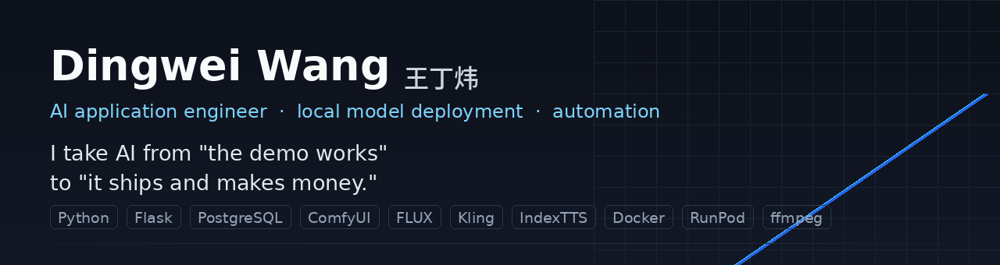

  

**I take AI from "the demo works" to "it ships and makes money."**

中文版 → [README.md](README.md)

  <a href="https://wangdinwei.github.io"><b>🖥 Personal site · wangdinwei.github.io</b></a>
  &nbsp;&nbsp;·&nbsp;&nbsp;
  <a href="mailto:476743538@qq.com">✉ Email</a>

---

## What I fix

| Where you are stuck | What I do |
|---|---|
| The AI feature works, but you don't dare ship it | Billing, permissions, concurrency, retries — the parts that make it survive real users |
| It's live and keeps failing, logs don't explain why | A fixed triage path (process → port → proxy → logs → DB → external API); usually root cause in a day |
| Model costs won't come down | Break down the cost first (in most projects 85% is video generation); cutting the reject rate beats switching vendors |
| The system gets worse with every change | Dependency and data-flow audit first, then small refactors in risk order — no downtime |
| You want AI in your product but don't know where to start | A concrete plan, a price, and phases that start with something verifiable |

## Track record

**An AI content production platform** — from script to finished video, 11 production stages, multi-user, billing, redoable. Not a demo.

| Scale | | |
|---|---|---|
| **64,752** lines of Python | **2,484** routes | **32** database tables |
| **626** page templates | **14,574** lines of JavaScript | **11** production stages |

Stack: Flask · PostgreSQL · Alembic · Jinja2 · esbuild · nginx · systemd · Kling · Alibaba Bailian · Volcengine · WeChat Pay v3 · Chatwoot

**[→ Architecture, trade-offs, and 21 real production failures](https://github.com/wangdinwei/ai-drama-pipeline)**

**Also:**

- **Multi-instance AI agent operations** — 10+ independent instances on one host: profile isolation, systemd, Docker sandboxing, version upgrades, auto-recovery
- **Local model tuning on a single 24 GB GPU** — FLUX/ComfyUI image, Wan/Sonic/LatentSync video and lipsync, IndexTTS speech, llama.cpp text
- **Document and data automation** — batch contract generation and review, ledger reconciliation, OCR reconstruction of scans, PDF typesetting, CAD extraction

## Repositories

| | Repo | What's in it |
|---|---|---|
| ✍️ | [engineering-notes](https://github.com/wangdinwei/engineering-notes) | **Articles**: 21 production failures, VRAM traps, payment pitfalls, cost structure |
| 📐 | [ai-drama-pipeline](https://github.com/wangdinwei/ai-drama-pipeline) | Case study: architecture, trade-offs, cost model, **21 real failures** |
| 🖥 | [local-gpu-deploy](https://github.com/wangdinwei/local-gpu-deploy) | Running open-source models on 24 GB: FLUX, ComfyUI, llama.cpp, music |
| 🎬 | [kling-ai-skills](https://github.com/wangdinwei/kling-ai-skills) | Kling video production: identity consistency, lipsync, prompt quality gates |
| 🧱 | [hermes-skills-kit](https://github.com/wangdinwei/hermes-skills-kit) | Engineering notes: 24 traps between demo and production |
| 📄 | [chinese-doc-toolkit](https://github.com/wangdinwei/chinese-doc-toolkit) | Chinese business documents in Python: contracts, quotations, scans |

## Stack

| Area | Tools |
|---|---|
| Languages | Python, JavaScript, SQL, Bash |
| Backend | Flask, FastAPI, Flask-SQLAlchemy, Alembic, Celery/threaded tasks |
| Data | PostgreSQL, SQLite, pandas/openpyxl |
| Frontend | Jinja2, vanilla JS, esbuild, hand-written CSS |
| Infra | Linux, systemd, Docker, nginx, Caddy, Cloudflare Tunnel, SSL/DDNS |
| Models | ComfyUI, FLUX, Wan, Sonic, LatentSync, IndexTTS, CosyVoice, Whisper, llama.cpp/vLLM |
| Cloud APIs | Kling, Alibaba Bailian/DashScope, Volcengine, Runway, WeChat Pay v3, Feishu Open Platform |
| Other | ffmpeg pipelines, Feishu/WeCom bots, document generation, jadx/apktool/Ghidra |

## Scope (so we both save time)

**I do**: AI application development, model integration and tuning, automation systems, rescue work, document/data automation
**I don't do**: design-only work, prompt-only work, decks without implementation, projects with no way to verify the result

**Mode**: remote, project-based or monthly.

## Contact

**Email: 476743538@qq.com** — fastest way to reach me
Need WeChat or a call? Say so in the email and I'll send details.

Updated regularly.
