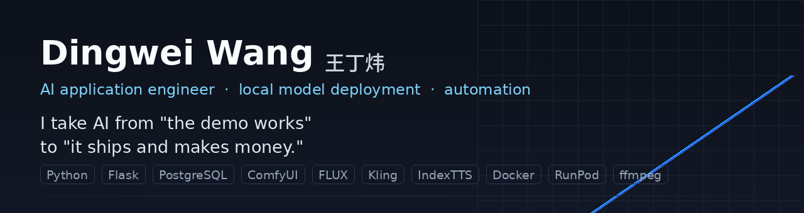

  

**把 AI 从「demo 跑通了」做到「能上线收钱」。**

EN · I take AI from "the demo works" to "it ships and makes money." — [English version](README.en.md)

  <a href="https://wangdinwei.github.io"><b>🖥 个人主页 · wangdinwei.github.io</b></a>
  &nbsp;&nbsp;·&nbsp;&nbsp;
  <a href="mailto:476743538@qq.com">✉ 476743538@qq.com</a>

---

## 我在解决这一类问题

| 你的处境 | 我做什么 |
|---|---|
| AI 功能做出来了，但不敢上线 | 补齐计费、权限、并发、失败重试，让它扛得住真实用户 |
| 上线了总出故障，日志看不出原因 | 按「进程 → 端口 → 反代 → 日志 → 数据库 → 外部 API」定位，一般一天内到根因 |
| 模型调用成本压不下来 | 先拆成本结构（多数项目 85% 花在视频生成），降废片率比换供应商有效 |
| 已有系统越改越乱 | 先做依赖与数据流审计，再按风险顺序小步重构，不停机 |
| 想接 AI，不知道从哪下手 | 给方案、报价、分期，先做能验证的那一步 |

## 做过什么

**一套 AI 内容生产平台** — 从剧本到成片，11 个生产步骤，多用户、计费、可重做，不是 demo。

| 规模 | | |
|---|---|---|
| **64,752** 行 Python | **2,484** 个路由 | **32** 张数据表 |
| **626** 个页面模板 | **14,574** 行 JavaScript | **11** 个生产步骤 |

技术栈：Flask · PostgreSQL · Alembic · Jinja2 · esbuild · nginx · systemd · Kling · 阿里百炼 · 火山引擎 · 微信支付 v3 · Chatwoot

**[→ 架构复盘、技术取舍、21 个真实故障](https://github.com/wangdinwei/ai-drama-pipeline)**

**另外做过的：**

- **多实例 AI Agent 运维**：一台机器上长期跑 10+ 个独立实例（profile 隔离、systemd、Docker 沙箱、版本升级、掉线自恢复）
- **本地模型调优（单卡 24G）**：FLUX/ComfyUI 出图、Wan/Sonic/LatentSync 视频与口型、IndexTTS 语音、llama.cpp 文本
- **文档与数据自动化**：批量合同生成与审查、台账核对、扫描件 OCR 重建、PDF 排版、CAD 信息提取

## 仓库

| | 仓库 | 内容 |
|---|---|---|
| 📐 | [ai-drama-pipeline](https://github.com/wangdinwei/ai-drama-pipeline) | 案例复盘：架构、取舍、成本模型、**21 个真实故障** |
| 🖥 | [local-gpu-deploy](https://github.com/wangdinwei/local-gpu-deploy) | 单卡 24G 跑开源模型：FLUX、ComfyUI、llama.cpp、音乐生成 |
| 🎬 | [kling-ai-skills](https://github.com/wangdinwei/kling-ai-skills) | 可灵视频生产：角色一致性、口型对齐、提示词质量门禁 |
| 🧱 | [hermes-skills-kit](https://github.com/wangdinwei/hermes-skills-kit) | AI 应用工程笔记：从 demo 到生产的 24 个坑 |
| 📄 | [chinese-doc-toolkit](https://github.com/wangdinwei/chinese-doc-toolkit) | 中文文档批量生产：合同、报价单、报表、扫描件重建 |

## 技术栈

| 类别 | 使用过的 |
|---|---|
| 语言 | Python、JavaScript、SQL、Bash |
| 后端 | Flask、FastAPI、Flask-SQLAlchemy、Alembic、Celery/线程任务 |
| 数据 | PostgreSQL、SQLite、pandas/openpyxl |
| 前端 | Jinja2、原生 JS、esbuild、手写 CSS |
| 部署 | Linux、systemd、Docker、nginx、Caddy、Cloudflare Tunnel、SSL/DDNS |
| 模型 | ComfyUI、FLUX、Wan、Sonic、LatentSync、IndexTTS、CosyVoice、Whisper、llama.cpp/vLLM |
| 云 API | 可灵 Kling、阿里百炼/DashScope、火山引擎、Runway、微信支付 v3、飞书开放平台 |
| 其他 | ffmpeg 全链路、飞书/企微 Bot、中文文档生成、jadx/apktool/Ghidra |

## 能力边界（说清楚，省双方时间）

**能做**：AI 应用开发、模型接入与调优、自动化系统、疑难排障、中文文档/数据自动化
**不做**：纯设计稿、纯提示词代写、只出方案不写代码、无法验证效果的项目

**方式**：远程，项目制或月度合作。

## 联系方式

**邮箱：476743538@qq.com** ← 最快能收到回复的渠道
需要微信 / 电话沟通的，邮件里说一声，我回你联系方式。

本页持续更新。
